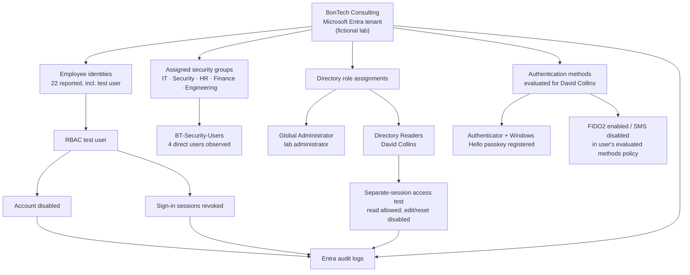

# BonTech Entra ID — Logical Security Architecture

The diagram below represents identity and security controls **observed in the training tenant**. It is not an Azure network architecture or a deployed application topology.

## Trust boundaries

| Boundary | Engineering implication |
|---|---|
| Tenant vs. Azure subscription | The directory controls identities; subscription/resource authorization is separately assigned. |
| Users vs. security groups | Membership organizes users but does not itself grant application permissions. |
| Directory role vs. effective access | The existence of an assignment requires direct validation under that identity. |
| Authentication method vs. MFA enforcement | Method registration and eligibility do not prove that every sign-in enforces MFA. |
| Administrative operation vs. active session | Disabling and revoking refresh sessions reduce continued access; existing access tokens can persist. |

## Scope explicitly not shown

No virtual network, application deployment, automated identity provisioning pipeline, custom Microsoft Graph automation, Conditional Access policy, PIM workflow, or tenant-wide MFA test was demonstrated in the guided project. Do not infer these from the diagram.
